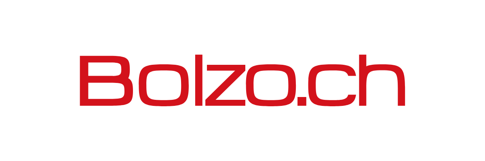
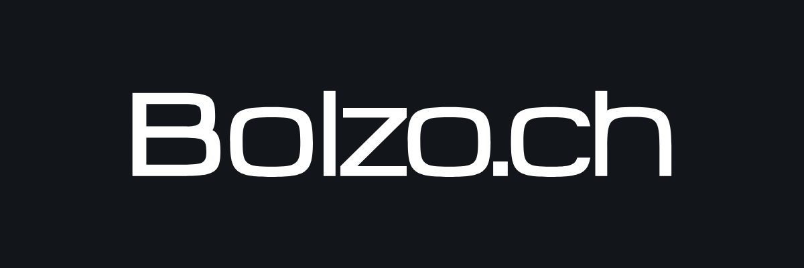
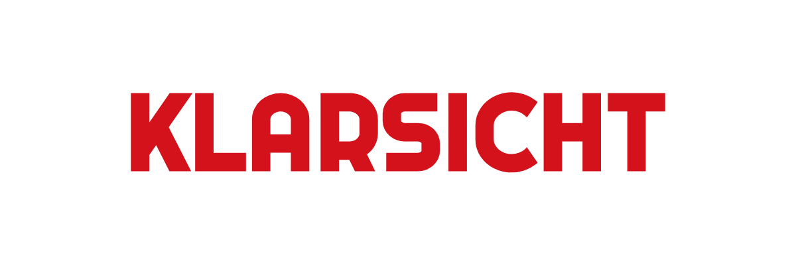
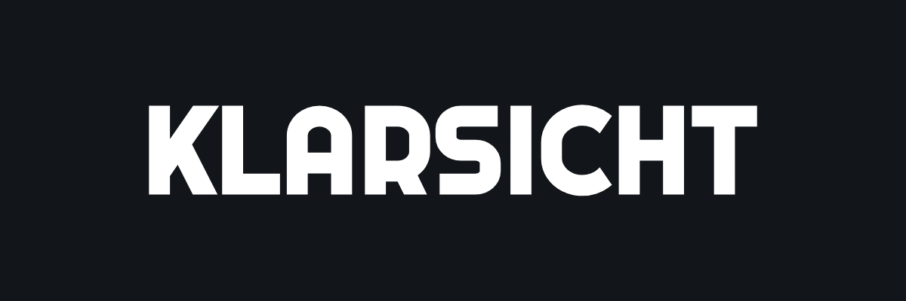
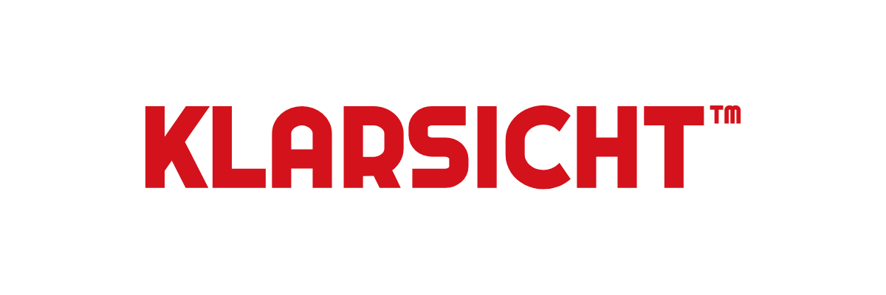
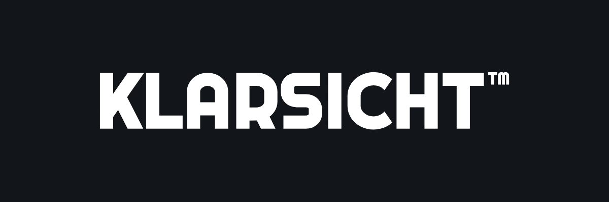
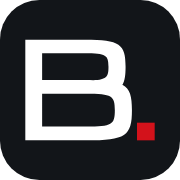

# Charte graphique Bolzo.ch

Version visuelle : [`charte.html`](charte.html), en ligne sur
https://jonlekern.github.io/Bolzo.ch/charte.html

## Logos

| Logo | Fond clair | Fond noir ou photo |
|---|---|---|
| **Bolzo.ch** Overshoot Gentle Breeze 400 |  |  |
| **KLARSICHT** Malabard ExtraBold 800 |  |  |
| **KLARSICHT TM** Pour les grands logos (pied de page, emballage) |  |  |

Fichiers dans [`marque/`](marque/), en SVG et en PNG transparent (2400 px) :

| Logo | Fond clair | Fond noir ou photo |
|---|---|---|
| Bolzo.ch | `logo-bolzo-rouge.svg` / `.png` | `logo-bolzo-blanc.svg` / `.png` |
| KLARSICHT | `logo-klarsicht-rouge.svg` / `.png` | `logo-klarsicht-blanc.svg` / `.png` |
| KLARSICHT TM | `logo-klarsicht-tm-rouge.svg` / `.png` | `logo-klarsicht-tm-blanc.svg` / `.png` |

**Favicon** :  B blanc et point rouge sur carré noir. Fichiers `marque/favicon.svg`, `favicon-32.png`, `favicon-180.png`, `favicon-512.png` et `favicon.ico` à la racine.

- Textes convertis en tracés : pas besoin d'installer les polices.
- Ne pas déformer, pas d'ombre, de contour ni de dégradé.
- Espace vide autour : au moins la hauteur d'une minuscule.
- Le symbole TM s'ajoute seulement sur les grands logos produit (ex. pied de
  page KLARSICHT).

## Couleurs

| Nom | Code | Usage |
|---|---|---|
| Rouge Bolzo | `#d3121b` | Logo, boutons d'achat, mot mis en avant, icônes |
| Rouge foncé | `#b30f17` | Survol des boutons rouges uniquement |
| Encre | `#121519` | Texte, bandeau du haut, pied de page, fonds noirs |
| Gris texte | `#59616b` | Texte secondaire, légendes, sur-titres |
| Gris clair sur noir | `#aab1ba` | Texte secondaire sur fond noir |
| Filet | `#d6dade` | Bordures et lignes |
| Fond | `#f2f4f5` | Fond des pages |
| Blanc | `#ffffff` | Cartes, en-tête, photos produit |

Une seule couleur vive : le rouge. Pas de dégradés.

## Polices

| Police | Rôle | Graisse |
|---|---|---|
| **Overshoot** Gentle Breeze | Logo Bolzo.ch, titres du site Bolzo | 400 uniquement |
| **Barlow** (Google Fonts) | Tout le texte courant, boutons, menus, étiquettes | 400, 500, 600 |
| **Malabard** ExtraBold | Seulement le nom KLARSICHT, en capitales | 800 uniquement |
| **Isocircle** 050 | Seulement les titres de la page KLARSICHT | 500 uniquement |

Chaque produit peut avoir sa police de nom (comme Malabard pour KLARSICHT). Le
site Bolzo garde Overshoot et Barlow.

Pas de faux gras ni de faux italique : on n'utilise que les graisses listées.

### Tailles

| Élément | Police | Taille | Détails |
|---|---|---|---|
| Grand titre (h1) | Overshoot 400 | 2.4 à 4.4rem | Interligne 1.05, un mot en rouge maximum |
| Titre de section (h2) | Overshoot 400 | 2 à 3rem | |
| Petit titre (h3) | Overshoot 400 | 1.35 à 1.5rem | |
| Sur-titre | Barlow 600 | 0.78rem | CAPITALES, espacement 0.14em, gris texte |
| Texte | Barlow 400 | 17px | Interligne 1.55 |
| Texte d'accroche | Barlow 400 | 1.15rem | Gris texte |
| Bouton | Barlow 600 | 1.05rem | |
| Étiquette | Barlow 600 | 0.7rem | CAPITALES, en pilule |

## Formes

- Coins arrondis **10px** : cartes, photos, boutons.
- **Pilule** (999px) : étiquettes, badges, bouton FR/DE.
- Bordures **1px** filet. Pas d'ombres.
- Cartes seulement pour les objets (produits, lots, avis).

## Boutons et liens

| Type | Style |
|---|---|
| Bouton principal | Fond rouge, texte blanc, coins 10px. Survol rouge foncé. |
| Bouton secondaire | Fond blanc, bordure 1.5px encre |
| Lien d'action | Texte encre, soulignement rouge 2px, flèche |

Un seul bouton rouge par zone.

## Icônes

- SVG dessinés au trait : `viewBox="0 0 24 24"`, trait 1.8, bouts arrondis.
- En rouge dans les listes d'arguments, en couleur du texte ailleurs.
- **Jamais d'emoji.**

## Mise en page

- Largeur max **1180px**, marges de côté **16px** minimum.
- Sections : 48 à 72px d'espace vertical sur ordinateur, 36 à 56px sur
  téléphone.
- Texte aligné à gauche.
- Toujours tester à 400px (téléphone) et 1280px (ordinateur).

## Photos

- Produit sur fond blanc, ou en situation réelle.
- Pas de filtre ni de texte ajouté, sauf pilules BEFORE / AFTER.
- Légende courte en gris, en FR et en DE.

## Ton

- On **tutoie**, en français (« tu ») et en allemand (« du »).
- **Allemand de Suisse** : « ss », jamais « ß ».
- Phrases courtes et concrètes. Pas de superlatifs, pas de fausse urgence, pas
  de faux avis.
- Prix en **CHF**, avec un point : `CHF 29.90`.
